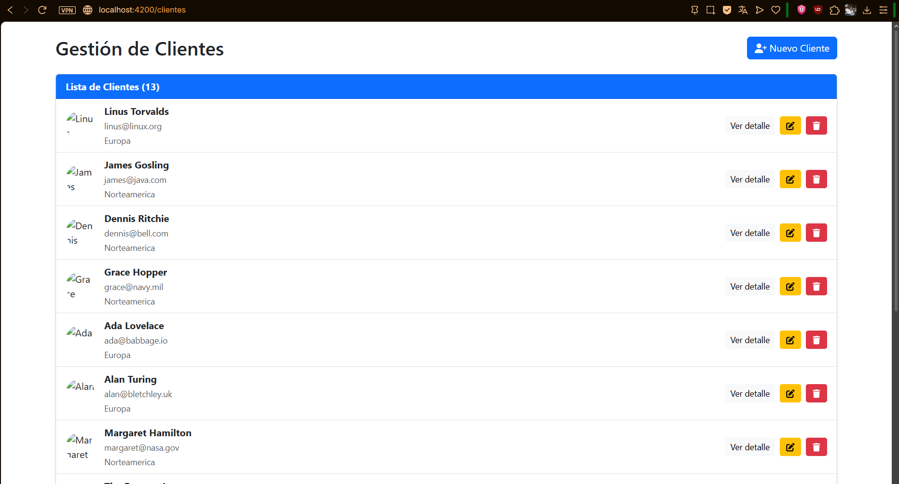
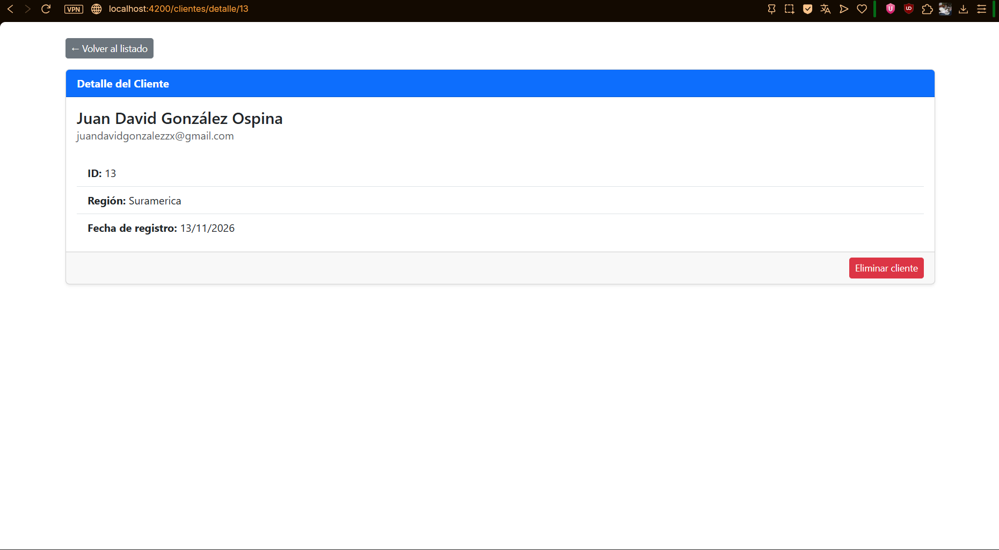

# Angular desde Cero: Aplicación de Clientes con Señales

Aplicación full-stack CRUD para la gestión de clientes desarrollada en **Angular 21** (componentes standalone, Signals y carga diferida) conectada a una API REST en **Spring Boot** y **PostgreSQL**.

## Ejecución del proyecto

1. **Backend (Docker):**
   ```bash
   cd backend
   docker compose --profile app up
   ```
2. **Frontend (Angular 21):**
   ```bash
   cd clientes-app
   npm install
   ng serve
   ```
   Abrir en el navegador: `http://localhost:4200`

## Evidencia de ejecución

### 1. Listado principal y contador reactivo (`computed`)


### 2. Consulta de detalle por parámetro de ruta (`input()` + `effect()`)
